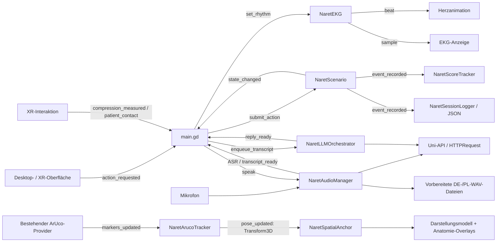

# Architektur

NaReT trennt die deterministische Trainingslogik von Tracking, Darstellung und Sprachdialog. `scripts/main.gd` instanziiert die Komponenten und verbindet ihre Signale. Die Domänenmodule benötigen keine Autoload-Singletons. Dadurch laufen Ablauf- und EKG-Tests ohne Headset, native Kameraerweiterung oder Cloudzugang.

## Verantwortlichkeiten

| Komponente | Aufgabe und Grenze |
| --- | --- |
| `NaretScenario` | Prüft Reihenfolge, 30:2-Zähler, AED-Freigaben und Übergänge. Eine Aktion ist ein Übungsereignis, kein Nachweis einer real ausgeführten Behandlung. |
| `NaretLanguage` | Liefert DE/PL-Anweisungen und erkennt eng begrenzte Kommunikationsabsichten. Freier Text kann keine körperliche Handlung oder Schockabgabe bestätigen. |
| `NaretEKG` | Erzeugt illustrative elektrische Kurven und das dazu synchrone mechanische Pulssignal, sofern der gewählte Simulationsrhythmus einen Puls besitzt. |
| `NaretScoreTracker` | Sammelt Meilensteinzeiten und Fehlergründe. Numerische Qualitätsbereiche werden ausschließlich für ausdrücklich verifizierte Messwerte gezählt. |
| `NaretSessionLogger` | Exportiert lokale strukturierte Übungsdaten. Keine automatische Übertragung; die Zustandsmaschine übernimmt keine freien Transkripte in ihre Ereignisse. |
| `NaretArucoTracker` | Adaptiert den vorhandenen nativen Marker-Provider. Es handelt sich nicht um eine neue ArUco-Implementierung. Der Desktop-Modus liefert eine klar gekennzeichnete Vorschaupose. |
| `NaretSpatialAnchor` | Verknüpft Markerpose und gespeicherten Kalibrierungsversatz. Der Versatz bleibt bei Bewegung im Koordinatensystem des Markers. |
| `NaretXRInteraction` | Verwendet die vorhandene Hand-/Kompressionslogik aus dem Avatar-Projekt, bedient XR-Panels und meldet Kontakt. Handbewegung ist ein Drucktiefen-Proxy. |
| `NaretAudioManager` | Erfasst Mikrofon-Audio, ruft ASR auf und organisiert Sprachausgabe sowie vorbereitete WAV-Dateien. |
| `NaretLLMOrchestrator` | Begrenzt und serialisiert Angehörigendialoge. Die Antwort darf Dialog und Emotion beeinflussen; die klinische Zustandsmaschine bleibt deterministisch. |
| `NaretUniAPIClient` | Stellt asynchrone HTTP-Anfragen mit Laufzeitkonfiguration, Bearer-Authentifizierung und begrenzten Antwortzeiten bereit. |

## Darstellung und reale Puppe

Das menschliche Darstellungsmodell und die reale Übungspuppe sind getrennte Komponenten. Die Darstellung verwendet anatomische Bezugspunkte für Herz, Brustkorb, Mund, Stirn und Pupillen. Modell, Rig und Animationen lassen sich ersetzen, während der Marker-Anker und das BLS-Szenario bestehen bleiben.

Der gescannte Torso in `mannequin_scan.glb` ist eine **optionale Referenz für die reale Puppe und ihre räumliche Ausrichtung**. Er ist nicht die Vorgabe für das Aussehen des menschlichen digitalen Zwillings. Seine ungefähr ausgewählten Oberflächenpunkte und die normalisierte Geometrie ersetzen keine Kalibrierung am tatsächlich eingesetzten Phantom. Provenienz und Größenangaben stehen in [MODELS.md](MODELS.md).

## Ablauf und Sicherheitsfreigaben

`submit_action(action, details)` ist die einzige öffentliche Schnittstelle für Trainingshandlungen. Die Oberfläche fragt passende Schaltflächen über `get_available_actions()` ab; die Zustandsmaschine prüft jede Aktion trotzdem erneut. `state_changed` aktualisiert die Darstellung, `event_recorded` versorgt Auswertung und Export. Die Anleitung wird über einen Sprachschlüssel aus `get_instruction_key()` angezeigt.

Ein Schock führt unmittelbar zurück zum CPR-Abschnitt. Erst eine ausdrücklich simulierte Übergabe oder von der Trainingsleitung gesetzte Lebenszeichen beenden den Ablauf. Ein Übergabeereignis allein erzeugt keinen Sinusrhythmus und keinen ROSC. Details zur ERC-2025-Grundlage stehen in [BLS.md](BLS.md).

## Cloud und Offlinebetrieb

Die Uni-Cloud übernimmt ASR, Sprachdialog und TTS. Zugangsdaten werden erst zur Laufzeit aus Prozessumgebung oder lokalem Benutzerprofil gelesen; die installierte App benötigt eine eigene Konfiguration. Die Zielmodelle und das Verhalten der überprüften Endpunkte stehen in [API.md](API.md).

Bei fehlender Verbindung verwendet die Anwendung vorbereitete DE/PL-Dialoge und WAV-Dateien. Die Trainingszustände, das EKG, die Oberfläche und der lokale Export laufen unabhängig davon weiter. Auch eine korrekt formulierte Cloudantwort ist keine Messung von Beatmung, Kompression oder Kreislaufzustand.

## Reproduzierbare Abhängigkeiten

Die drei Upstream-Repositories liegen als Git-Submodule unter `third_party/`. Ihre Commitstände werden vom Hauptrepository festgelegt. `tools/setup_dependencies.py` übernimmt benötigte Laufzeitdateien in `addons/` und passt Ressourcenpfade an; die Upstream-Checkouts werden dabei nicht verändert. Der native ArUco-Teil und OpenXR-Vendors werden für Zielhardware separat bereitgestellt. Ohne passende native Bibliothek bleibt der Desktop-Vorschaumodus nutzbar.

## Automatische Prüfung

[`.github/workflows/test.yml`](../.github/workflows/test.yml) verwendet die offizielle [Godot-Version 4.7.2](https://github.com/godotengine/godot-builds/releases/tag/4.7.2-stable) mit festem SHA-256 für die Linux-Binärdatei. Der Workflow checkt Submodule rekursiv aus, übernimmt die benötigten Quellskripte und führt im Offlinebetrieb drei Prüfungen aus:

1. Import aller eingecheckten Szenen, Modelle und Audio-Assets.
2. Domänen- und Adaptertests über `tests/run_tests.gd`.
3. Vollständiger DE/PL-Szenendurchlauf über `--smoke-test`.

Die CI verwendet ausdrücklich den Desktop-Modus ohne native ArUco-Erweiterung. Ein lokal generierter `[editor_plugins]`-Abschnitt und das optionale native Addon werden nur im kurzlebigen CI-Checkout entfernt. Alle Godot-Aufrufe setzen `--headless --xr-mode off`; ein Headset ist nicht erforderlich. Fehlerausgaben werden zusätzlich zum Prozessstatus geprüft, weil ein Editor-Import trotz Skriptfehlern mit Status 0 enden kann.

Die automatischen Prüfungen ersetzen weder Kamera-/Handtracking-Tests auf der Quest noch klinische Freigabe, Fachübersetzungsprüfung oder einen gemessenen Nachweis des 72-FPS-Ziels. Der Workflow erstellt keine Veröffentlichung und führt keinen Cloudaufruf mit Projektzugangsdaten aus.
